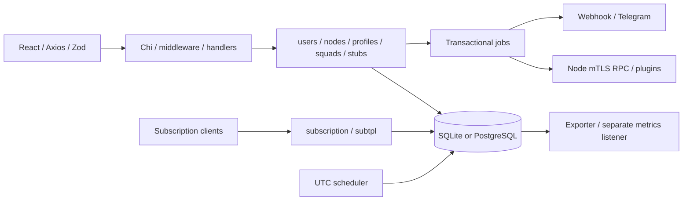

# Architecture baseline — pinned GoWave

Аудит исходников: `d709bad01dc0ceacb20012a3afdf528eddfd061f`. RustWave перед этапом: `bc5694f61fd407417f1d9a0d3bc57d2d0a8d9123`, `rustwave-dev`. Go/React/installer/Docker/workflows/LICENSE сверены через `git diff <upstream SHA> -- ...`: различий нет. Upstream main не используется как эталон. Rust backend не создавался.

## Проверяемая граница инвентаря

[Функциональная матрица](FUNCTIONAL_PARITY_MATRIX.md) содержит каждую явно зарегистрированную операцию и дополнительные группы поведения. [HTTP registry](audit/HTTP_ROUTES.md), [Go packages](audit/GO_PACKAGES.md), [все Go symbols](audit/GO_SYMBOLS.md), [модели](audit/DATABASE_TABLES.md), [fixtures](audit/FIXTURES.md), [frontend callsites](FRONTEND_API_SHAPE_MATRIX.md) позволяют перепроверить знаменатель. Счётчик функций означает элементы матрицы, а не все математически возможные состояния программы. Source inventory не доказывает runtime parity.

## Слои и жизненный цикл

`backend-go/main.go` и `cmd/server/main.go` вызывают `server.Run`. Run устанавливает UTC, обрабатывает version/service/update modes, загружает `.env` и `../.env`, открывает БД и применяет numbered migrations/default seeds. Большинство rescue/import CLI modes также открывают/мигрируют БД; нельзя запускать их на действующей базе ради smoke test. PG→SQLite имеет ранний отдельный путь. Root startup может создать `/usr/local/bin/gowave`; аудиторский runtime запускается без root.

Конфигурация валидируется до bind. API listener bind происходит до workers. `NewApp` собирает GORM services, Chi router, HTTP handlers, node client/keygen, scheduler, notifier, queue, subscriptions, metrics; `Start` запускает фоновые циклы. Tests могут использовать Router без Start. HTTP ReadHeaderTimeout 15 s, Read/WriteTimeout 5 min; SIGTERM/interrupt отменяет workers, HTTP shutdown 5 s и flush subscription history до 5 s.

`stubs` — реальные plugins/integrations/shared lists/snippets/HWID/connections/metadata/subscriptions/bandwidth/auth bridges. Имя пакета не означает отсутствие реализации. Infrabilling и SSH vault/terminal — самостоятельные области. Config rendering отделён от subscription formatting. Точный список handlers и tests дан в приложениях, включая пакеты без собственных tests.

## Контракт HTTP, auth и frontend

Успешные JSON-ответы обычно `{response: ...}`; `httpx.Error` выдаёт timestamp/path/message/errorCode. Это не универсальный формат: middleware.Auth использует `http.Error` с `{"error":"Unauthorized"}`/Forbidden; metrics — message/statusCode; update check — объект без response envelope. Требуется сравнивать фактический Content-Type, trailing newline, status, cookie и body, а не навязывать единый красивый формат. ContractStatus корректирует успешные статусы по embedded contract.

Public: health/auth status (GET и HEAD), login/register, passkey authentication, OAuth callbacks и `/api/sub/*`. Protected group: HS256 JWT с обязательным exp, наличие ADMIN/API записи в БД, scopes registry и AdminOnly prefixes. SSH имеет собственный one-time ticket и WS subprotocol auth. Backend tools используют OTT → `rw-tools` cookie (HttpOnly, SameSite Strict, conditional Secure, path `/api/backend-tools`, 2 h), удаляют OTT из redirect URL; mutations требуют same origin. Отдельного refresh/logout API в route registry нет: frontend logout — очистка auth state/401 event; это отдельный UI сценарий, а не придуманный endpoint.

Frontend package **3.4.4**, React **19.3.1**, Bun **1.4.2**, backend-contract **3.4.15**. Версии подтверждены `package.json` и `bun.lock`, embedded commands.version также 3.4.15. Зависимости не обновлялись. Go module требует **1.27.1**; фактическая измерительная toolchain записана в baseline. Прямые зависимости и пакетные imports доступны в go.mod и [package inventory](audit/GO_PACKAGES.md); frontend использует Mantine, React Query, Axios, Zod, Monaco, Xterm, WebAuthn и browser crypto. `build` сам по себе не выполняет typecheck.

Frontend по умолчанию выбирает window.location.origin в production; DOMAIN_OVERRIDE и development меняют домен. Axios добавляет Bearer и browser-client header, 401 вызывает logout. Query factories парсят query и response через Zod, возвращают `result.data.response`; mutation factory может не иметь response schema. Не считать TypeScript generic runtime validation. [Custom calls и UI](audit/FRONTEND_CUSTOM.md) дополняют [полные request/response schemas](audit/CONTRACT_SHAPES.md), включая required/null/enum/nesting.

## Данные и транзакционные границы

SQLite: glebarez/modernc (без CGO), WAL, busy_timeout 5000, synchronous NORMAL, foreign_keys ON, один open/idle connection. PG: pgx/GORM, default pool 20, idle timeout 10 min, lifetime 1 h. PostgreSQL URL распознаётся и при отсутствии DB_DRIVER. `NowFunc` UTC. Тестовый PG создаёт отдельную случайно названную schema и удаляет её; SQLite — migrated in-memory DB.

По семь миграций в `internal/database/migrations/{sqlite,postgres}`: initial, port fields, job results, branding, node config error, response rule headers, node traffic tracking start. `AutoMigrate` — wrapper numbered SQL + seeds, не destructive GORM reconciliation. SQL исполняется по одной non-comment строке; `ADD COLUMN table column definition` обрабатывается отдельно. Таблица `gowave_migrations` сохраняет версии. Импортированные PG foreign-key типы учитываются runner-ом. Изменение model struct не равно миграции.

Состояние пользователей и node-sync outbox сохраняется в одной transaction. Jobs имеют target ordering, lease recovery, attempts/backoff и retention (completed 24 h / failed 7 d); PG использует SKIP LOCKED и advisory transaction lock. SQLite single connection требует использовать transaction handle. Restore сначала читает tar.gz → sql.gz COPY blocks в staging SQLite, проверяет структуру, затем переносит в destination transaction с sequence repair; после restore сбрасывается node client и запускается sync. Нужны malformed archive, missing table, FK, partial failure и rollback fixtures на обеих БД.

## Фоновые процессы и внешние зависимости

`App.Start`: subscription history writer, Telegram preflight, panel_started notification, cron, queue, node health, initial user sync, metrics exporter. Зарегистрированы user-sync/node-start/node-stop/node-retire/torrent-collect/plugin-sync/plugin-exec/connections-drop/geocheck и notification jobs. Cron tick 15 s; UTC DAY 00:05, rolling 00:10, Monday WEEK 00:15, first-of-month MONTH 00:20, node reset 01:00, billing 17:00, jobs cleanup hourly; optional usage cleanup Monday 00:30, expiration notifications every minute, not-connected every 10 min. Persistent cursor и bounded catch-up — часть parity.

Metrics export 15 s, user-stat cache 1 min, series cleanup 6 h. Экспортёр стартует независимо от METRICS_ENABLED; флаг отключает listener. Node RPC, OAuth/OIDC discovery, Telegram, webhook, GitHub release checks, external docs/templates/schema downloads требуют локальных mock replies и отдельного live-integration gate. Внешние nodes/prod во время аудита не используются.

## CLI, установка и доставка

CLI: version; service install; update apply; rescue/cli и aliases; reset/list/create admin; password auth; print node key; PasarGuard import; PG→SQLite; SQLite→PG; migration to Docker с backup/preflight/wrapper и остановкой service в реальном применении. Dedicated backup-create HTTP route не обнаружен: backup/export операционные команды, миграционные backup и restore API должны учитываться раздельно. API user streaming — не полный DB backup.

`install.sh`: native SQLite либо Docker PostgreSQL, bilingual wizard, channels stable/dev, reverse proxy Caddy/Nginx, port/domain checks, service installation/update. `scripts/migrate-node.sh` — отдельный привилегированный installer node, не dev helper. Они прочитаны; реальная установка на host/VPS не выполняется.

Native systemd service — gowave, binary/frontend root-owned, install dir root:gowave со sticky bit для DB; panel пишет update request, root helper проверяет ownership и SHA256SUMS. Dockerfile: Bun frontend → Go static backend → Alpine 3.24, UID/GID 10001, frontend не embedded. Compose: PostgreSQL 18, read-only app, tmpfs /tmp, cap_drop ALL, no-new-privileges, loopback API/metrics/PG ports, health ordering. Исходный compose имеет фиксированные имена gowave-network/containers; аудит его не запускает, чтобы не пересечь существующие установки.

CI `ci.yml`: PR/workflow_call; Go fmt/vet/race SQLite/PG/build, frozen Bun/check/typecheck/tests/build, branding/installer/response-headers, contract export и четыре live probes, Docker build. Browser smoke есть отдельным script, в CI не включён. dev workflow — push main; release v* — reusable CI, linux amd64/arm64 binaries, frontend tar, SHA256SUMS, multiarch GHCR. Push rustwave-dev сам по себе не доказывает CI run.

## License/attribution inventory

LICENSE содержит GNU AGPL v3, Copyright 2025 Remnawave и 2026 Gowave Contributors; frontend package license `AGPL-3.0-only`. Исходная лицензия и атрибуция сохранены. Для будущих модифицированных поставок необходимо сохранить notices/license, отмечать изменения и предоставить Corresponding Source; §13 исходного LICENSE требует предложения исходников пользователям модифицированной сетевой версии. Это перечень требований из файла проекта, не заключение о лицензиях всех транзитивных пакетов. Отдельного tracked NOTICE в корне не обнаружено; полный dependency license audit ещё не выполнялся. Не удалять legacy identifiers из branding allowlist.

## Источники недетерминизма и будущий harness

| Источник | Код / риск | Требование к fixtures |
|---|---|---|
| Wall clock / timezone | auth expiry, users, cron, jobs, subscription daysLeft, metrics uptime | UTC/locale; injected test clock; boundary cases minute/day/week/month/DST; сохранять timezone shape |
| UUID / secret / crypto | uuid.New, crypto/rand, keygen, tickets, OAuth state, salts | test-only deterministic injection либо проверяемые crypto vectors; production CSPRNG сохранить |
| DB order / numeric coercion | SQLite text/PG timestamptz, uint64/int64 vs JS number, JSON arrays | одинаковая clean fixture, explicit sorting только там, где контракт допускает; missing/null/empty и >2^53 |
| Workers / leases / retries | jobs, async history, notifications, node health | ручной clock/worker drain, fixed mock network; assert transactional outbox before/after failure |
| Global state | metrics registry, notify default, subtpl.Now, processStart, time.Local, counters | process/test isolation, reset hooks; порядок repeated/shuffled runs; race detector |
| Host stats / filesystem | procfs, RSS, PID, mtime, gzip timestamps, MIME registry | pinned image/arch; per-field tolerances только для динамических метрик; фиксированные static files/mtime |
| External network | node RPC, OAuth, Telegram, GitHub, docs/assets | local mocks with fixed bodies/status/deadlines; no internet in differential core |
| UI browser | locale/tz, polling, visibility, animations, empty/error states | pinned Chromium, clock, viewport, initial storage; network traces without credentials |

Existing fixtures pin parts of subscription rendering/time/randomness. Generator `scripts/subscription-diff/setup-upstream.sh` references Remnawave commit `010b365ab1fabea01192b5e6ade4e98e66ee1dbd`, Node 24.21.0 and Bun; legacy UPSTREAM_REPO is an input, not available automatically. Audit uses committed golden files, never derives expected Go output from future Rust. No fixture regeneration was needed.

Future parity manifest must cross IDs × Go/Rust × SQLite/PG × required architectures and UI scenario. Missing results, skipped, ignored, xfail, pending, todo, unknown, unexpected pass and filtered-out fail closed. Add negative test proving skipped mandatory ID rejects gate. Baseline original tests contain real skip branches, including minute-boundary flakiness; preserve and report them rather than deleting assertions. No normalization is currently approved; enumerate each field before implementing it.

## Final audit execution evidence

Source inventory: 304 declared items, 248 HTTP/WS operations and 221 frontend callsites; 1772/1772 LF upstream blobs unchanged after execution. First CRLF formatting FAIL and source provenance are preserved in [archive integrity](audit/ARCHIVE_INTEGRITY.md). Measured Go/DB baseline is in [GO_BASELINE](benchmarks/GO_BASELINE.md). Both corrected Go suites and frontend checks ran; skips, first browser timeout and successful idle retry remain in [test ledger](TEST_INVENTORY.md). Docker build/inspect PASS independently of the denied optional Buildx history command (NOT_RUN). Strict stage gate PARTIAL; Rust compatibility NOT_TESTED. No Rust backend implemented.
